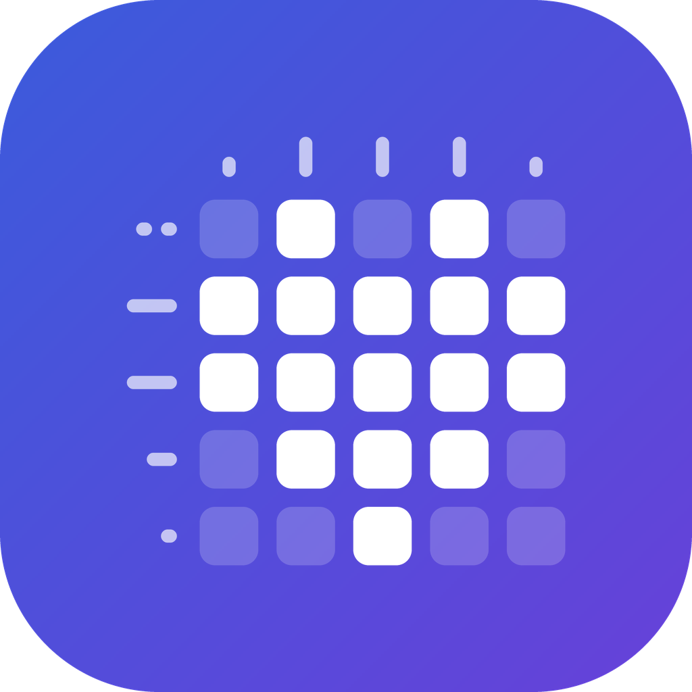

# Nonopix




**Nonopix** là game nonogram (tô ô theo gợi ý số để lộ ra hình) viết bằng
Flutter, tách ra từ project Nexora. **Chạy offline hoàn toàn**: màn chơi đóng gói sẵn trong app,
tiến độ lưu trên máy, không cần tài khoản hay mạng.

## Chạy game

```bash
flutter pub get
flutter run --flavor dev      # Android: luôn phải chọn flavor
```

### Flavor

| Flavor | Dùng cho | Màn chọn chế độ chơi | Bộ màn |
|---|---|---|---|
| `dev` | Bản thử nội bộ, mặc định trên GitHub Actions (workflow Distribute) | Có | Chế độ người dùng (`assets/levels/`) + chế độ nhà phát triển (`assets/levels_dev/`) |
| `store` | Bản phát hành lên store (workflow "Store build", chạy tay) | Không | Chỉ `assets/levels/` |

- Mỗi chế độ chơi lưu tiến độ riêng. Chế độ nhà phát triển dùng lại box tiến
  độ cũ (`nonogram_offline_v1`), nên tiến độ của các bản thử trước đây vẫn còn.
- `assets/levels_dev/` (574 màn lấy từ nonogram.org, không được dùng thương
  mại) chỉ được đóng gói khi build `--flavor dev`.
- Build bản store: `flutter build appbundle --release --flavor store`.
- iOS và web chưa cấu hình flavor: build không có `--flavor` chạy như bản
  `store` (không có chế độ nhà phát triển).
- Nhánh `beta` giữ nguyên trạng thái `main` trước khi đổi bộ màn (vẫn dùng bộ
  màn crawl).

Hỗ trợ Android, iOS và Web. Giao diện có tiếng Việt và tiếng Anh (theo ngôn ngữ máy).

Bản web cần build kèm CanvasKit để chạy được khi không có mạng:

```bash
flutter build web --no-web-resources-cdn
```

## Điều khiển

Nút gạt **Tô / X** trên thanh công cụ chọn việc một lần chạm sẽ làm:

| Thao tác | Chế độ Tô (■) | Chế độ X (✕) |
|---|---|---|
| Chạm | Tô / xoá ô tô | Đánh / bỏ X |
| Nhấn giữ | Đánh X vào ô trống | Tô ô |
| Kéo một ngón bắt đầu trên lưới | Tô liên tiếp | Đánh X liên tiếp (không đè ô đã tô) |
| Kéo một ngón trên dải gợi ý trái | Cuộn dọc; vuốt ngang để xem các số bị cắt | như bên trái |
| Kéo một ngón trên dải gợi ý trên | Cuộn ngang; vuốt dọc để xem các số bị cắt | như bên trái |
| Kéo một ngón trên chỗ trống | Kéo bàn | Kéo bàn |
| Hai ngón | Kéo bàn | như bên trái |
| Chuột / trackpad | Lăn để kéo | như bên trái |

- Đang tô mà ngón tay tới sát mép lưới thì bàn tự trôi theo.
- Hai dải gợi ý luôn dính mép trái / mép trên khi kéo lưới đi. Mỗi dải
  chiếm tối đa 30% chiều tương ứng; nhiều số hơn thì chỉ hiện các số gần
  lưới nhất, ô góc báo còn bao nhiêu số bị cắt (`← +N`, `↑ +N`).
- Không có zoom: cỡ ô luôn là cỡ lớn nhất vừa màn hình trong khoảng
  28–44px (tính lại khi xoay màn hình); lưới lớn hơn thì kéo để xem.
- Nút xoay màn hình (điện thoại / máy tính bảng) chuyển dọc ⇄ ngang và khoá
  ở hướng đó; rời trang chơi thì bỏ khoá.
- Màn hình ngang tự ẩn thanh hệ thống, không có app bar. Cột trái: quay
  lại và ⓘ ở góc trên, xoay màn hình và cài đặt ở góc dưới. Bấm ⓘ thì bảng
  thông tin màn (tên, số màn, kích thước, độ khó) trượt ra từ trái, phủ lên
  hai nút góc trên; cột nới rộng theo bảng nên bảng không che bàn chơi.
  Trạng thái mở / thu gọn được nhớ trên máy. Mép phải chỉ còn gợi ý, gậy
  phép và Tô / X (theo thứ tự đó), ở góc trên bên phải.
- "Chơi lại từ đầu" nằm trong Cài đặt và luôn hỏi xác nhận.
- Ô trống trên hàng/cột đã khớp gợi ý hiện chấm tròn; X màu chàm là dấu
  người chơi tự đánh.

## Hướng dẫn chơi

- Lần đầu mở app (chưa giải màn nào), bài **Cách chơi** tự mở: một câu đố
  5×5 hiện dần từng hàng, mỗi bước có lời dẫn, viền vàng chỗ cần làm và bàn
  tay chỉ chỗ cần chạm. Chỉ nhận đúng thao tác của bước đó; làm sai thì lời
  dẫn rung nhẹ. Có nút **Bỏ qua**.
- Học xong có nút **Xem các kỹ thuật giải** dẫn sang trang Hướng dẫn (lý
  thuyết). Trên trang Hướng dẫn có thẻ **Học qua bài tập** để mở lại.
- Kịch bản (bài 5×5, các bước) nằm trong
  `lib/screens/tutorial/nonogram_tutorial_controller.dart`.

## Cấu trúc

```
lib/
  main.dart                  Khởi tạo Hive, repository, MaterialApp
  core/                      Theme (AppTheme + GameColors), điều hướng (AppRouteIntent), tiện ích
  data/
    nonogram_puzzle_source.dart   Đọc màn chơi từ assets/levels/
    hive_nonogram_local_service.dart  Lưu ván dở + màn đã hoàn thành
    nonogram_repository.dart      Gom dữ liệu màn chơi + tiến độ, logic campaign
  models/                    Puzzle, snapshot ván dở, kết quả hoàn thành
  screens/
    dashboard/               Màn chính: chơi tiếp / thử thách tiếp theo, thống kê
    play/                    Gameplay (bloc, engine, solver, bố cục bàn chơi, UI)
    history/                 Danh sách + chi tiết màn đã hoàn thành
    guide/                   Hướng dẫn cách giải (lý thuyết, có lối vào bài tập)
    tutorial/                Bài hướng dẫn tương tác 5×5 ("Cách chơi")
    painters/                CustomPainter cho lưới, gợi ý, đáp án
  l10n/                      Chuỗi dịch (app_en.arb, app_vi.arb)
assets/
  levels/                    121 màn chơi có bản quyền (sinh bằng tools/build_levels.dart)
  levels_dev/                574 màn crawl, chỉ có ở flavor dev (chế độ nhà phát triển)
  licenses/                  Văn bản giấy phép hình màn chơi (hiện ở Cài đặt → Giấy phép)
  fonts/                     Font Nunito (giấy phép OFL, xem Nunito-OFL.txt)
tools/
  build_levels.dart          levels.json -> assets/levels/, kiểm tra nghiệm duy nhất
  image_levels/              Sinh + duyệt màn từ bộ icon mở giấy phép (nguồn của assets/levels/)
  generate_icons.py          Vẽ launcher icon / splash / favicon
docs/
  level_format.md            Định dạng dữ liệu màn chơi
  credits.md                 Ghi công + giấy phép hình dùng làm màn chơi
  gameplay_rules.md          Quy tắc campaign, snapshot, hint
```

- Sửa chuỗi dịch trong `lib/l10n/*.arb` rồi chạy `flutter gen-l10n`.
- Thêm/cập nhật màn chơi: xem [docs/level_format.md](docs/level_format.md).

## Kiểm tra

```bash
dart format --output=none --set-exit-if-changed lib test
flutter analyze
flutter test
```

`test/data/level_assets_test.dart` kiểm tra toàn bộ dữ liệu trong
`assets/levels/` (đủ level, đúng định dạng, mỗi màn có đúng một nghiệm).

## Phát hành (Firebase App Distribution)

Chỉ phát hành qua GitHub Actions. App Android `com.chauvb.nonogram`
(**Nonopix**) nằm chung project Firebase với app chess (`chess-app-chauvb`).

- Workflow `CI` chạy format/analyze/test cho mỗi push và pull request.
- Workflow `Distribute` build APK release và đẩy lên Firebase App
  Distribution sau khi CI trên `main` xanh, hoặc chạy tay từ tab Actions
  (có ô nhập ghi chú phát hành).
- Số build = số thứ tự lần chạy của workflow `Distribute`, tự tăng mỗi lần
  phát hành.

Secrets/variables cần cấu hình được mô tả ở đầu
`.github/workflows/distribute.yml`.

### Logo

`tools/generate_icons.py` vẽ lại toàn bộ launcher icon, splash, icon web và
`assets/branding/logo.png` (logo 1024px để dùng cho Firebase/store).
