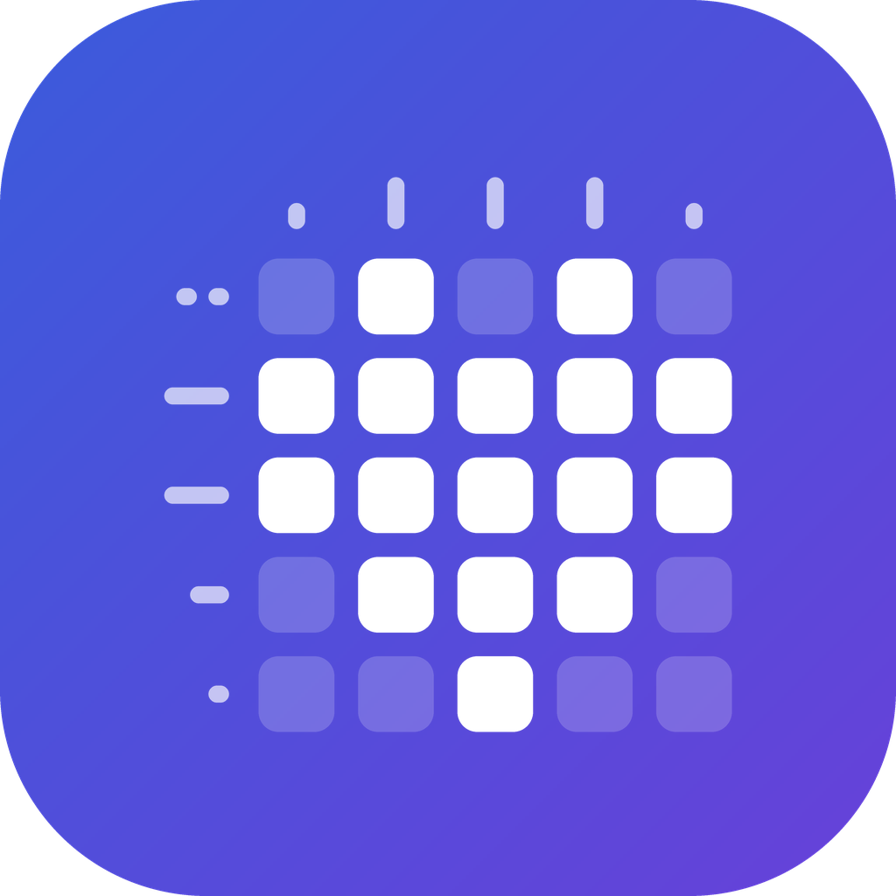

# Pixel Nonogram




**Pixel Nonogram** là game nonogram (tô ô theo gợi ý số để lộ ra hình) viết bằng
Flutter, tách ra từ project Nexora. **Chơi được khi không có mạng**: màn chơi đóng gói sẵn trong app,
tiến độ lưu trên máy, không cần tài khoản. Mạng chỉ dùng để tải quảng cáo
(bản store trên Android, xem [Quảng cáo](#quảng-cáo-admob)).

## Chạy game

```bash
flutter pub get
flutter run
```

Nhánh `main` là mã nguồn của bản store: không có flavor, công cụ tester hay
chế độ nhà phát triển (các thứ đó nằm ở nhánh `develop`, xem
[Nhánh và phát hành](#nhánh-và-phát-hành)).

- Build bản store: `flutter build appbundle --release --obfuscate --split-debug-info=build/symbols`.
  Bản release Android bật R8 (làm rối + rút gọn, keep rules ở
  `android/app/proguard-rules.pro`) và `--obfuscate` làm rối mã Dart. Lưu lại
  thư mục `build/symbols` (và `mapping.txt` của R8) để giải mã stack trace.
- Tiến độ người chơi lưu trong box Hive `nonogram_offline_user_v1`: không đổi
  tên box này.

Hỗ trợ Android, iOS và Web.

## Điều hướng

Thanh điều hướng dưới có 3 tab (`lib/screens/home/app_home_page.dart`):

- **Chính** (`NonogramDashboardPage`): màn tiếp theo kèm nút Chơi, tiến trình,
  vừa giải xong.
- **Điểm danh** (`CheckInTab`): xem [Điểm danh hằng ngày](#điểm-danh-hằng-ngày).
- **Tôi** (`MePage`): gói không quảng cáo; cài đặt (giao diện: bấm là đổi
  Sáng ⇄ Tối, ngôn ngữ, âm thanh); trợ giúp (cách chơi, kỹ thuật giải); quyền
  riêng tư quảng cáo (khi bắt buộc), giấy phép.

## Ngôn ngữ

Giao diện có 15 ngôn ngữ: Anh, Việt, Tây Ban Nha, Bồ Đào Nha, Pháp, Đức, Ý,
Nga, Thổ Nhĩ Kỳ, Indonesia, Thái, Nhật, Hàn, Trung giản thể và Trung phồn thể.

- Mặc định theo ngôn ngữ của máy; máy dùng ngôn ngữ không có trong danh sách
  thì hiện tiếng Anh. Máy báo `zh_TW` / `zh_HK` / `zh_MO` (Android cũ, không
  có mã chữ viết) dùng tiếng Trung phồn thể (`resolveAppLocale` trong
  `lib/core/app_locale.dart`).
- Người chơi đổi được ngôn ngữ ở tab **Tôi** hoặc trong Cài đặt khi đang chơi; lựa chọn được lưu trên máy (chọn "Theo ngôn ngữ của
  máy" để bỏ).
- Tên màn chơi (lấy từ tên icon gốc) giữ nguyên tiếng Anh ở mọi ngôn ngữ.
- **Thêm ngôn ngữ:** tạo `lib/l10n/app_<mã>.arb` (đủ mọi khoá của
  `app_en.arb`), chạy `flutter gen-l10n`, thêm vào `appLanguages` trong
  `lib/core/app_locale.dart` và `CFBundleLocalizations` trong
  `ios/Runner/Info.plist`.
- `test/core/app_locale_test.dart` kiểm tra mọi file `.arb` đủ khoá, đúng
  placeholder và khớp danh sách chọn ngôn ngữ;
  `test/l10n/locale_layout_test.dart` dựng các màn chính bằng từng ngôn ngữ
  trên điện thoại 360×640 (font Nunito thật) để bắt chữ dịch bị tràn.

Bản web cần build kèm CanvasKit để chạy được khi không có mạng:

```bash
flutter build web --no-web-resources-cdn
```

## Điều khiển

Nút gạt **Tô / X** trên thanh công cụ chọn việc một lần chạm sẽ làm:

| Thao tác | Chế độ Tô (■) | Chế độ X (✕) |
|---|---|---|
| Chạm | Tô / xoá ô tô | Đánh / bỏ X |
| Nhấn giữ | Đánh X vào ô trống | Tô ô |
| Kéo một ngón bắt đầu trên lưới | Tô liên tiếp | Đánh X liên tiếp (không đè ô đã tô) |
| Kéo một ngón trên dải gợi ý trái | Cuộn dọc; vuốt ngang để xem các số bị cắt | như bên trái |
| Kéo một ngón trên dải gợi ý trên | Cuộn ngang; vuốt dọc để xem các số bị cắt | như bên trái |
| Kéo một ngón trên chỗ trống | Kéo bàn | Kéo bàn |
| Hai ngón | Kéo bàn | như bên trái |
| Chuột / trackpad | Lăn để kéo | như bên trái |

- Đang tô mà ngón tay tới sát mép lưới thì bàn tự trôi theo.
- Hai dải gợi ý luôn dính mép trái / mép trên khi kéo lưới đi. Mỗi dải
  chiếm tối đa 30% chiều tương ứng; nhiều số hơn thì chỉ hiện các số gần
  lưới nhất. Hàng / cột nào còn số khuất thì ở mép phía đó (xa lưới, hoặc
  sát lưới khi đã cuộn dải ra) có chip cam `+n` to bằng một ô số; n đếm cả
  số nằm dưới chip (`ClueOverflow`).
- Không có zoom: cỡ ô luôn là cỡ lớn nhất vừa màn hình trong khoảng
  28–44px (tính lại khi xoay màn hình); lưới lớn hơn thì kéo để xem.
- Nút xoay màn hình (điện thoại / máy tính bảng) chuyển dọc ⇄ ngang và khoá
  ở hướng đó; rời trang chơi thì bỏ khoá.
- Màn hình ngang tự ẩn thanh hệ thống, không có app bar. Cột trái: quay
  lại và ⓘ ở góc trên, xoay màn hình và cài đặt ở góc dưới. Bấm ⓘ thì bảng
  thông tin màn (tên, số màn, kích thước, độ khó) trượt ra từ trái, phủ lên
  hai nút góc trên; cột nới rộng theo bảng nên bảng không che bàn chơi.
  Trạng thái mở / thu gọn được nhớ trên máy. Mép phải chỉ còn gợi ý, gậy
  phép và Tô / X (theo thứ tự đó), ở góc trên bên phải.
- "Chơi lại từ đầu" nằm trong Cài đặt và luôn hỏi xác nhận.
- Ô trống trên hàng/cột đã khớp gợi ý hiện chấm tròn; X màu chàm là dấu
  người chơi tự đánh.

## Hướng dẫn chơi

- Lần đầu mở app (chưa giải màn nào), bài **Cách chơi** tự mở: một câu đố
  5×5 hiện dần từng hàng, mỗi bước có lời dẫn, viền vàng chỗ cần làm và bàn
  tay chỉ chỗ cần chạm. Chỉ nhận đúng thao tác của bước đó; làm sai thì lời
  dẫn rung nhẹ. Có nút **Bỏ qua**.
- Học xong có nút **Xem các kỹ thuật giải** dẫn sang trang Hướng dẫn (lý
  thuyết). Trên trang Hướng dẫn có thẻ **Học qua bài tập** để mở lại.
- Kịch bản (bài 5×5, các bước) nằm trong
  `lib/screens/tutorial/nonogram_tutorial_controller.dart`.

## Giải xong màn và âm thanh

- Giải xong một màn: sóng lan trên lưới từ góc trái dưới lên góc phải trên,
  từng ô tô nổi lên rồi hạ xuống, dấu X mờ dần. Sau đó sang màn kết quả: một
  khung chạy vòng quanh tranh, tranh vừa thu nhỏ vừa bay vào thẻ kết quả,
  khung thành viền thẻ, rồi phần còn lại của màn kết quả hiện dần. Máy bật
  giảm chuyển động hoặc mở lại màn đã giải thì sang thẳng màn kết quả.
  Code: `lib/screens/play/celebration/solve_celebration.dart`.
- Âm thanh: tô ô, đánh X / xoá ô, khớp xong hàng / cột, sóng giải xong, tranh
  bay, tranh đáp. Tắt / bật trong Cài đặt khi đang chơi (lưu trên máy). Tiếng
  game hoà chung với nhạc đang phát, iOS im khi máy để chế độ im lặng.
- File tiếng (`assets/sounds/*.wav`) được tổng hợp bằng code, không dùng mẫu
  âm của bên thứ ba: `python3 tools/generate_sounds.py assets/sounds` (cần
  numpy).

## Cấu trúc

```
lib/
  main.dart                  Khởi tạo Hive, repository, quảng cáo, MaterialApp
  ads/                       Quảng cáo AdMob (có thưởng + xen kẽ), tần suất, ID
  core/                      Theme (AppTheme + GameColors), điều hướng (AppRouteIntent), tiện ích
  data/
    nonogram_puzzle_source.dart   Đọc màn chơi từ assets/levels/
    hive_nonogram_local_service.dart  Lưu ván dở + màn đã hoàn thành
    nonogram_repository.dart      Gom dữ liệu màn chơi + tiến độ, logic campaign
  models/                    Puzzle, snapshot ván dở, kết quả hoàn thành
  screens/
    dashboard/               Màn chính: chơi tiếp / thử thách tiếp theo, thống kê
    play/                    Gameplay (bloc, engine, solver, bố cục bàn chơi, UI)
    history/                 Danh sách + chi tiết màn đã hoàn thành
    guide/                   Hướng dẫn cách giải (lý thuyết, có lối vào bài tập)
    tutorial/                Bài hướng dẫn tương tác 5×5 ("Cách chơi")
    painters/                CustomPainter cho lưới, gợi ý, đáp án
  l10n/                      Chuỗi dịch (app_<mã>.arb, 15 ngôn ngữ) + code sinh từ đó
assets/
  levels/                    1.061 màn chơi có bản quyền (sinh bằng tools/build_levels.dart)
  licenses/                  Văn bản giấy phép hình màn chơi (hiện ở Cài đặt → Giấy phép)
  fonts/                     Font Nunito (giấy phép OFL, xem Nunito-OFL.txt)
tools/
  build_levels.dart          levels.json -> assets/levels/, kiểm tra nghiệm duy nhất
  image_levels/              Sinh + duyệt màn từ bộ icon mở giấy phép (nguồn của assets/levels/)
  generate_icons.py          Vẽ launcher icon / splash / favicon
docs/
  level_format.md            Định dạng dữ liệu màn chơi
  credits.md                 Ghi công + giấy phép hình dùng làm màn chơi
  gameplay_rules.md          Quy tắc campaign, snapshot, hint
  conventions.md             Quy ước code và quy trình Git
```

- Sửa chuỗi dịch trong `lib/l10n/*.arb` rồi chạy `flutter gen-l10n`.
- Thêm/cập nhật màn chơi: xem [docs/level_format.md](docs/level_format.md).

## Kiểm tra

```bash
dart format --output=none --set-exit-if-changed lib test tools
flutter analyze
dart run tools/check_conventions.dart
flutter test
```

Quy ước code (độ dài file, đặt tên, cách kiểm tra) xem
[docs/conventions.md](docs/conventions.md).

`test/data/level_assets_test.dart` kiểm tra toàn bộ dữ liệu trong
`assets/levels/` (đủ level, đúng định dạng, mỗi màn có đúng một nghiệm).

## Quảng cáo (AdMob)

Có quảng cáo trên **Android** (bản debug / profile luôn dùng ID thử
nghiệm). iOS, web và test không có (`createAdService` trong
`lib/main.dart`).

| Loại | Khi nào |
|---|---|
| Có thưởng | Kho gợi ý / gậy phép hết: badge hiện icon quảng cáo, bấm là phát quảng cáo, xem xong dùng luôn một lượt (xem [docs/gameplay_rules.md](docs/gameplay_rules.md)) |
| Xen kẽ | Bấm "Màn tiếp" / "Trang chính" ở màn hoàn thành, nếu đã qua 5 phút kể từ quảng cáo xen kẽ trước đó (quảng cáo có thưởng không tính), hoặc từ lúc mở app nếu chưa có quảng cáo nào (`lib/ads/interstitial_policy.dart`) |

- Khi mở app, SDK hỏi ý kiến đồng ý theo GDPR (UMP, chỉ ở vùng bắt buộc).
  Người dùng ở các vùng đó thấy thêm nút **Quyền riêng tư quảng cáo** trong
  Cài đặt.
- Không có mạng / quảng cáo chưa tải xong: bấm vào báo chưa sẵn sàng, không
  trừ gì; khe quảng cáo tự tải lại (giãn cách 10 s → ~5 phút).

### Kiến trúc (`lib/ads/`)

```
Game ──AdPlacement──▶ AdService (ad_service.dart)
                         │  AdManager: đồng ý → tần suất → đã tải?
                         ▼
                      AdNetwork (network/ad_network.dart)
                         │  ConsentGate + FullScreenAdSlot cho mỗi dạng
                         ▼
                      AdMobNetwork (network/admob/) ──▶ đấu giá / mediation
```

- Game chỉ biết **vị trí** (`AdPlacement`: `hint_refill`, `wand_refill`,
  `level_complete`), không biết mạng quảng cáo nào.
- **Bật đấu giá trên AdMob:** cấu hình mediation group / bidding trên web
  AdMob và thêm package adapter `gma_mediation_*` (Meta, AppLovin, Unity,
  Pangle...). Không phải sửa code game.
- **Đổi sang AppLovin MAX / LevelPlay:** viết một `AdNetwork` mới (consent +
  slot) rồi đổi một dòng trong `createAdService`.
- **Doanh thu:** mỗi lượt hiển thị phát `AdPaid` (giá trị, tiền tệ, nguồn
  thắng thầu, vị trí) qua `AdEventSink`; hiện chỉ ghi log khi debug, sau này
  nối Firebase Analytics / AppsFlyer bằng một sink mới.
- **Cấu hình** (`AdConfig`, `InterstitialPolicyConfig`) tách khỏi code, sẵn
  sàng đọc từ Remote Config.
- **ID quảng cáo:** bản release dùng ID thật của Pixel Nonogram, bản debug / profile
  dùng ID thử nghiệm của Google (luôn hiện quảng cáo mẫu, không ra tiền):
  `AdConfig.forBuild` trong `lib/ads/ad_config.dart`. App ID ở
  `android/app/build.gradle.kts`.
- Thử quảng cáo trên máy: `flutter run` (quảng cáo mẫu). Chạy `--release` là
  **quảng cáo thật**: đừng bấm vào, AdMob sẽ khoá tài khoản vì lượt bấm
  không hợp lệ; muốn thử bản release thì thêm máy vào **Cài đặt → Thiết bị thử
  nghiệm** trong AdMob trước.

- **Privacy policy:** nằm ở repo
  [`vubaochau-coder.github.io`](https://github.com/vubaochau-coder/vubaochau-coder.github.io),
  file `nonogram/privacy/index.html`, đăng tại
  https://vubaochau-coder.github.io/nonogram/privacy/. Dùng URL này cho Play
  Console và thông báo GDPR trên AdMob. Thêm SDK / dữ liệu mới thì cập nhật
  trang ở repo đó. Repo này **không bật GitHub Pages** (nếu bật, nó chiếm
  đường dẫn `/nonogram/` và che mất trang chính sách).
- **app-ads.txt:** cũng ở repo `vubaochau-coder.github.io`, tại
  https://vubaochau-coder.github.io/app-ads.txt.

## Điểm danh hằng ngày

`lib/checkin/`. Điểm danh là tab thứ 2 của app (không tự mở); icon tab có
chấm đỏ khi hôm nay chưa điểm danh. Nút **"Điểm danh hôm nay"** nổi ở cuối
tab, ẩn khi đã điểm danh.

- **Hiệu ứng** (`check_in_celebration.dart`): bấm nút thì nút vỡ như bong
  bóng, một quả cầu sáng bay lên ô hôm nay và đóng dấu tích. Ngày có quà mốc:
  huy hiệu quà lắc, hộp quà bay ra giữa màn hình, rung, bật nắp (tia sáng,
  pháo giấy), bấm **Nhận** (hoặc nút quay lại) thì phần quà bay về thẻ "Quà
  trong tháng". Quà trong ngày của gói không quảng cáo chỉ báo bằng thông báo
  nhỏ. Máy bật giảm chuyển động: điểm danh ngay, không hiệu ứng.

- **Mọi người chơi:** cứ 5 lần điểm danh (cộng dồn số ngày, bỏ lỡ không mất
  tiến độ) nhận một quà mốc **vĩnh viễn**, xoay vòng gợi ý → gợi ý → gậy phép.
- **Người mua gói không quảng cáo:** thêm 2 gợi ý + 1 gậy phép **trong ngày**
  mỗi lần điểm danh, hết hạn cuối ngày, không cộng dồn; vẫn nhận quà mốc.
- **Kho 2 phần** (`PowerUpInventory`): lượt vĩnh viễn (tặng ban đầu, quà mốc)
  và lượt trong ngày; dùng lượt trong ngày trước. Badge trên nút gợi ý / gậy
  phép màu vàng khi còn lượt trong ngày, màu primary khi chỉ còn lượt vĩnh
  viễn. Trang chính có thẻ nhắc khi còn lượt trong ngày chưa dùng.
- **Lịch:** ngày đã điểm danh nền gradient với số nhỏ và dấu tích trắng, chưa
  điểm danh chỉ có viền, hôm nay viền đậm. Không ghi quà trong ô: ngày có quà
  mốc có huy hiệu hộp quà ở góc (đã nhận: dấu tích vàng; ngày tới tính theo
  giả sử từ nay ngày nào cũng điểm danh). Xem được các tháng từ lúc cài app;
  cuối trang là tổng quà tháng (đã nhận / tối đa).
- **Chống chỉnh giờ:** giờ của game = giờ máy + độ lệch so với giờ mạng
  (`GameClock`, header `Date` từ `https://www.google.com/generate_204`, đo lại
  mỗi lần mở app); thêm bánh cóc: chỉ điểm danh khi hôm nay sau ngày điểm danh
  gần nhất và không sớm hơn ngày muộn nhất từng thấy.

## Gói "Chơi không quảng cáo"

Chỉ trên Android (`lib/premium/`), mua một lần qua Google Play, mã sản phẩm
**`remove_ads`** (tạo trong Play Console → Kiếm tiền → Sản phẩm trong ứng
dụng). Thẻ mua nằm ở tab Tôi, hiện giá theo tiền của người dùng; cửa
hàng không dùng được hoặc chưa có sản phẩm thì ẩn.

- Tắt quảng cáo xen kẽ (`AdEntitlements`); quảng cáo có thưởng vẫn còn để
  lấy thêm lượt.
- Quà trong ngày khi điểm danh (xem [Điểm danh](#điểm-danh-hằng-ngày)).
- Trạng thái đã mua lưu trên máy (dùng được khi mất mạng), đối chiếu lại với
  Google Play mỗi lần mở app: tự khôi phục khi cài lại, thu hồi khi đã hoàn
  tiền. Mọi giao dịch được xác nhận (`completePurchase`), nếu không Google sẽ
  tự hoàn tiền sau 3 ngày.
- Thử mua thật: tải bản build lên kênh thử nghiệm nội bộ, thêm tài khoản vào
  License testing trong Play Console.

## Đánh giá app

Chỉ trên Android (`lib/rating/`). Khi bấm "Màn tiếp" / "Trang chính" ở màn
hoàn thành, nếu đến lúc thì hiện hộp thoại chọn 1–5 sao, và lần đó không hiện
quảng cáo xen kẽ.

- Lần đầu sau 5 màn đã giải. "Để sau" thì hỏi lại sau 15 màn nữa, tối đa 3
  lần (`RatingPolicy`).
- 5 sao: mở trang app trên CH Play (`market://`, không có thì mở trang web).
  Ít hơn: cảm ơn và ở lại trong game. Đã chọn sao thì không hỏi nữa.

## Nhánh và phát hành

| Nhánh | Dùng cho | GitHub Actions |
|---|---|---|
| `develop` | Phát triển và thử nội bộ: có flavor `dev` / `store`, công cụ tester, chế độ nhà phát triển | `CI` tự chạy cho mỗi push / pull request vào develop; CI xanh thì `Distribute` đẩy bản thử lên Firebase App Distribution |
| `main` | Mã nguồn của bản store: không có flavor và code kiểm thử | Không tự chạy gì. Khi cần phát hành thì chạy tay `Store build` |

App Android `com.chauvb.nonogram` (**Pixel Nonogram**) nằm chung project Firebase
với app chess (`chess-app-chauvb`).

- `Distribute` build APK release flavor `dev` từ nhánh `develop`; chạy tay từ
  tab Actions cũng được (có ô nhập ghi chú phát hành). Số build = số thứ tự
  lần chạy của workflow, tự tăng mỗi lần phát hành.
- `Store build` chạy format / analyze / test rồi build `.aab` đã ký; số build
  nhập tay khi chạy.
- File workflow giống nhau ở cả hai nhánh: GitHub đọc trigger của
  `Distribute` từ nhánh mặc định (`main`), nên sửa workflow thì sửa cả hai.

Secrets/variables cần cấu hình được mô tả ở đầu
`.github/workflows/distribute.yml`.

### Logo

`tools/generate_icons.py` vẽ lại toàn bộ launcher icon, splash, icon web và
`assets/branding/logo.png` (logo 1024px để dùng cho Firebase/store).

## Giấy phép

Mã nguồn được chia sẻ để mọi người học hỏi, theo
[PolyForm Noncommercial 1.0.0](LICENSE):

- **Được:** clone, chạy, đọc, sửa code để học hoặc làm dự án cá nhân, và chia
  sẻ lại cho mục đích phi thương mại (kèm file `LICENSE` và dòng
  `Required Notice`).
- **Không được:** dùng cho bất kỳ mục đích thương mại nào, gồm cả phát hành
  app (kể cả bản đổi tên / đổi giao diện) có quảng cáo, thu phí hay mua trong
  app.

Giấy phép này **không** áp dụng cho:

- Hình màn chơi và dữ liệu nonogram của bên thứ ba trong `assets/levels/` và
  `tools/image_levels/`: theo giấy phép gốc của từng nguồn (CC0, CC BY, CC
  BY-SA, MIT), xem [docs/credits.md](docs/credits.md).
- Font, icon và thư viện bên thứ ba: theo giấy phép riêng của chúng.
- Tên "Pixel Nonogram", logo và hình ảnh trên cửa hàng: không được dùng cho
  app khác.

Muốn dùng cho mục đích thương mại, hãy liên hệ chủ repo qua GitHub.
